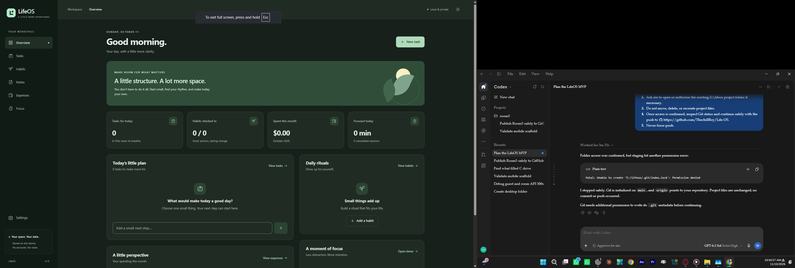

# LifeOS

A buildless, local-first productivity app. HTML, CSS and vanilla JavaScript ES modules; no backend, runtime dependencies, accounts, analytics or external APIs.



## Run locally

Install Node.js 20 or newer, then run from this directory:

```
npm start
```

Open http://127.0.0.1:4173. A server is required for ES modules; do not open index.html as a file. This preview server applies the same security headers as the Cloudflare Pages configuration.

## Features

- Dashboard: today's tasks, habit progress, this month's expenses and completed focus minutes.
- Tasks: create/edit/delete, complete/reopen, optional local due dates, Today/Upcoming/Completed. Today includes overdue and undated tasks.
- Habits: daily check-ins, current streak and seven-day history. A missed check-in today does not break yesterday's streak. Check-ins use local calendar dates.
- Notes: plain text, search, autosave after 400 ms, explicit saving/saved/error state, manual save and guarded navigation. Failed writes leave the editor text available to copy/retry.
- Expenses: manual entries, fixed categories, monthly filtering/totals and exact minor-unit arithmetic. Choose a currency in Settings before entering expenses. Currency is locked while records exist.
- Focus: 25-minute focus / 5-minute break, pause/resume/reset, timestamp recovery and atomically recorded completed focus sessions. Breaks start manually. Unfinished sessions are not recorded. There is no background notification when the browser is closed.
- Settings: system/light/dark theme, currency, validated JSON backups and atomic restore after confirmation. Exported running timers become paused; restore never starts a timer automatically.

## Data and privacy

IndexedDB database `lifeos`, version 1, has separate object stores for tasks, habits, check-ins, notes, expenses, focus sessions and settings. localStorage holds only the early-render theme preference. There is no silent storage fallback; failed writes are shown as failures.

Data belongs to a browser profile and origin, is unencrypted, and may disappear when site data is cleared. Browser storage is not a backup. Keep regular JSON exports privately. Import supports LifeOS version 1, at most 10 MB and 50,000 total records. Imports reject duplicates, invalid dates, orphaned check-ins, inconsistent timers, unsafe money values and mixed currencies before changing storage.

Database migrations belong in the `onupgradeneeded` handler. Increase both the database and backup schema versions deliberately when changing persisted formats; preserve existing records and add migration tests. The MVP currently has only version 1.

## Cloudflare Pages

Use an existing Git repository or upload the contents of `web/` with Direct Upload. For Git integration: framework preset **None**, production branch **main**, build command **exit 0**, output directory **web**. No install/build step or Pages Functions is needed.

`web/_headers` configures CSP, framing protection, MIME protection, a private referrer policy and disabled camera/microphone/location. Hash navigation needs no server rewrites.

Use one stable production origin. Preview deployment addresses, custom domains and localhost each have separate local data. Export on the old origin and restore on the new one before changing the address users rely on. Deployment is not performed by the local preview server.

## Verification

```
npm test
```

`tests/browser.test.mjs` uses Playwright (development-only) for IndexedDB, all six workflows, backup/restore, write failures, timer recovery, multiple tabs, responsive layout and basic accessibility checks. Install Playwright in your development environment and its Chromium/Firefox/WebKit browsers, then run `node tests/browser.test.mjs` while the preview server is running. `PLAYWRIGHT_MODULE` may point to an existing installation. `BROWSER=firefox` or `BROWSER=webkit` selects another engine. WebKit testing is not a substitute for a final Safari-on-device check.

`tests/accessibility.test.mjs` adds automated WCAG A/AA audits of all screens in both themes at 1440px and 320px, plus form/navigation dialogs. To install optional development tools: `npm install --save-dev playwright @axe-core/playwright`, then `npx playwright install`. Run the accessibility suite with `node tests/accessibility.test.mjs`. These packages are never deployed or loaded by the app.

Before release, run keyboard and screen-reader checks, test actual Safari and a mobile device, verify HTTPS/security headers on the deployed Pages origin and audit Lighthouse with targets of 90+ performance/accessibility. See `VERIFICATION.md` for checks performed in this workspace.

## Milestones

1. Foundation: responsive shell, tokens, hash navigation, transactional IndexedDB and backups.
2. Daily planning: task workflows and daily habits.
3. Personal records: autosaving notes and exact expense totals.
4. Focus and dashboard: timestamp timer and derived summaries.
5. Release: test workflows, browser failures, accessibility and static hosting package.

The MV3 extension remains a separate future milestone, documented in `extension/README.md`.
